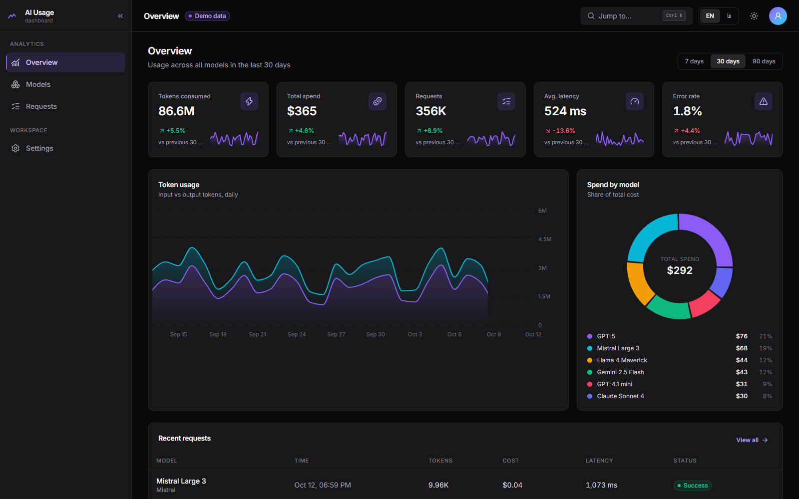
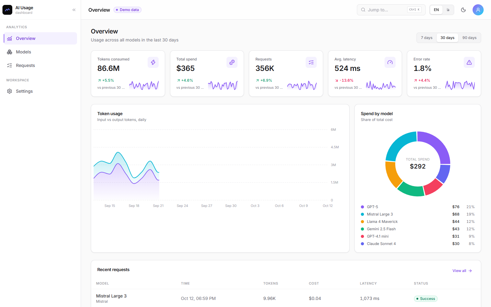
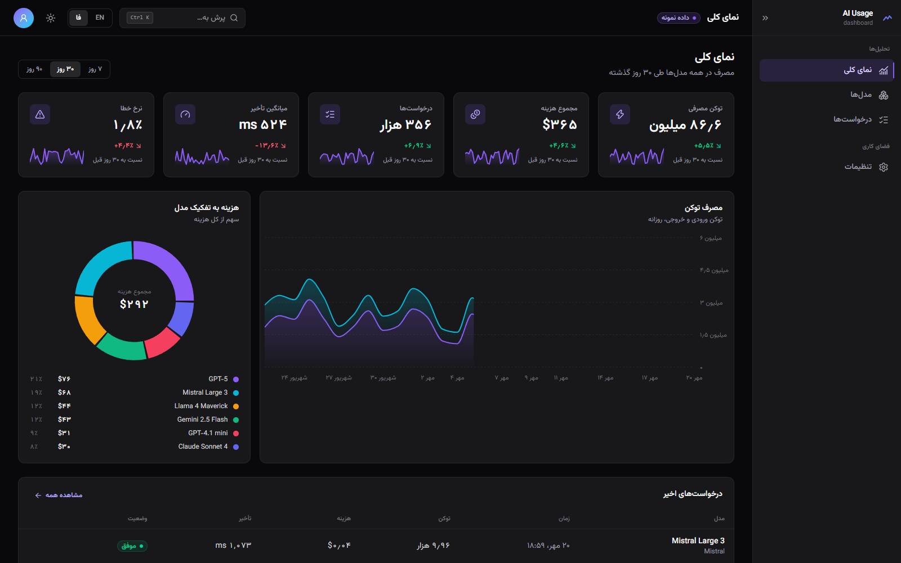
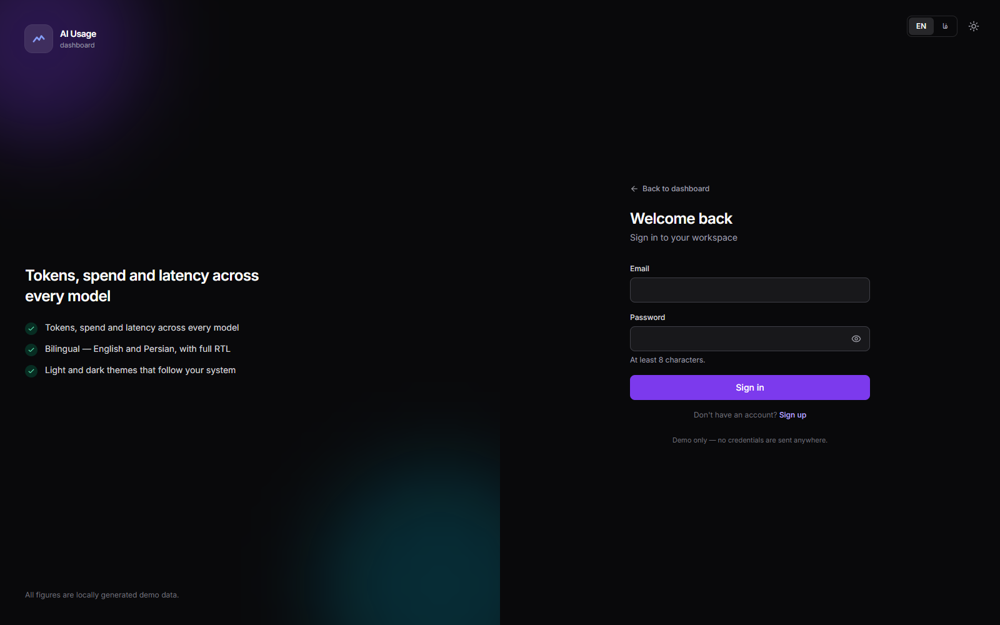
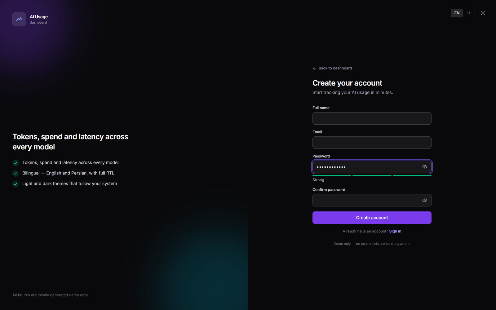
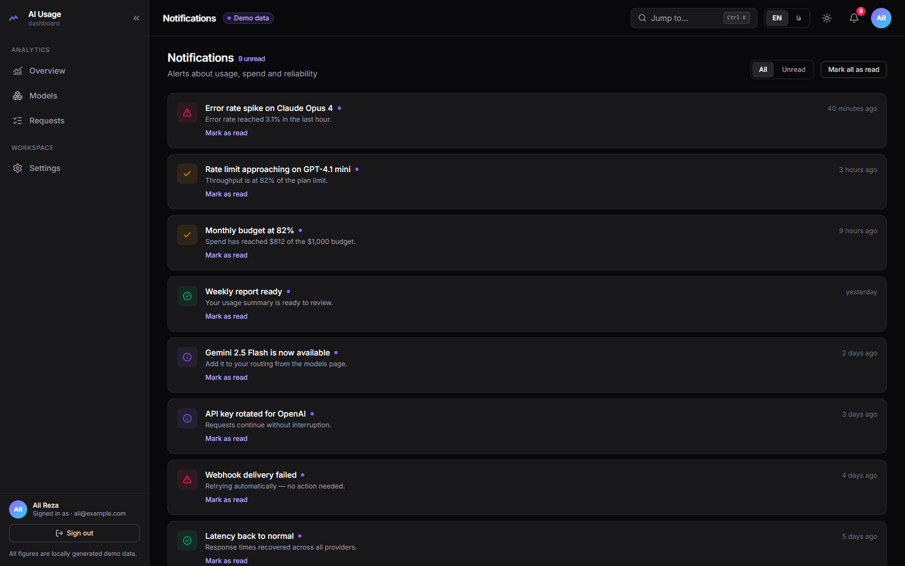
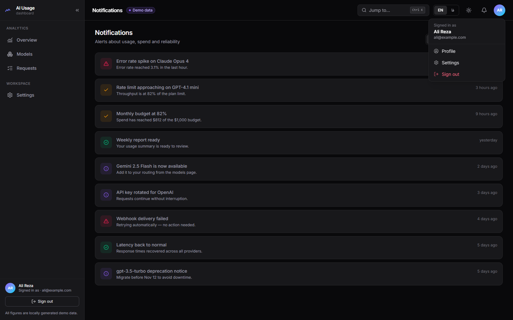

# AI Usage Dashboard

[](https://github.com/AliSardari/AI-Agent-dashboard/actions/workflows/ci.yml)

A modern, **bilingual (فارسی / English)** dashboard for monitoring AI model usage — tokens, spend, latency and request logs across nine models from six providers.



- **RTL/LTR**: switching to Persian flips the whole layout, not just the strings.
- **Light & dark**: class-based theming, persisted before first paint (no flash — system preference respected on first visit too).
- **Command palette**: `⌘K` / `Ctrl+K` (or `/`) to jump anywhere or toggle the theme.
- **Real states**: skeletons while data "loads", empty state when filters match nothing, recoverable error states with retry.
- **Fast**: route-level code splitting keeps the initial bundle at ~110 kB gzipped; the charting library only downloads when a chart page opens.

<p align="center">
  
  
</p>

Plus a complete **auth flow** (client-side demo): split-screen sign-in/sign-up with field-level validation, password strength meter and show/hide toggle — bilingual and RTL-aware.

<p align="center">
  
  
</p>

Plus a **notifications center** (bell with unread badge in the header, mark-as-read flows synced through a tiny `useSyncExternalStore` store) and an **account dropdown** with profile, settings and sign-out.

<p align="center">
  
  
</p>

> All figures are locally generated demo data — deterministic, offline, and never leaves the browser.

## Stack

| Concern    | Choice                                       |
| ---------- | -------------------------------------------- |
| Framework  | React 19 + TypeScript (strict)               |
| Build      | Vite 6 (route-level code splitting)          |
| Styling    | Tailwind CSS v4 (`@tailwindcss/vite`)        |
| Charts     | Recharts 3                                   |
| Routing    | React Router 7                               |
| i18n       | Typed dictionary, compile-time enforced      |
| Testing    | Vitest + Testing Library (jsdom)             |
| Linting    | ESLint 9 flat config + typescript-eslint     |

## Features

| Page      | What it shows                                                        |
| --------- | -------------------------------------------------------------------- |
| Overview  | 5 KPI cards with sparklines, token usage area chart, spend donut, recent requests |
| Models    | Pricing, context window, success rate, latency chart, share-of-spend bars |
| Requests  | 256-row log with search, status filter and pagination                 |
| Settings  | Theme, language, stack and storage notes                             |
| Profile   | Account card — guest prompt when signed out, details when signed in  |
| Notifications | Alert list with unread badge, all/unread filter and mark-as-read |
| Login / Register | Split-screen auth demo with validation, strength meter and session state |

Plus a 404 route, a collapsible sidebar (persisted), a mobile drawer, a global error boundary, and a focus-trapped command palette.

> **Demo auth**: signing in stores a session in `localStorage` only — no credentials ever leave the browser, and the dashboard stays browsable without an account.

## Getting started

```bash
npm install
npm run dev        # http://localhost:5173
```

| Script              | What it does                        |
| ------------------- | ----------------------------------- |
| `npm run dev`       | Dev server with HMR                 |
| `npm run build`     | Typecheck + production build        |
| `npm run preview`   | Serve the production build          |
| `npm run lint`      | ESLint                              |
| `npm run typecheck` | `tsc --noEmit`                      |
| `npm test`          | Vitest once                         |
| `npm run test:watch`| Vitest in watch mode                |

## Project structure

```
src/
├── components/
│   ├── charts/        # Recharts wrappers (area, donut, bars) + shared tooltip
│   └── ui/            # Card, Badge, controls, skeletons, error boundary
├── data/usage.ts      # Seeded demo dataset (models, daily usage, request log)
├── hooks/             # useUsageData — simulated fetch with loading/error/retry
├── i18n/              # Typed en/fa dictionaries, provider, bound formatters
├── layout/            # AppLayout, Sidebar, Header, CommandPalette
├── lib/               # formatters, aggregates, cn(), platform helpers
├── pages/             # Overview, Models, Requests, Settings, NotFound
├── theme/             # ThemeProvider + context
└── test/              # Vitest setup and suites
```

## Design notes

- **Type-safe translations**: `en` defines the key set, `fa` must match it exactly — a missing or renamed key is a compile error, and tests assert placeholder parity too.
- **Logical properties everywhere** (`ps-`, `pe-`, `text-start`, `border-e`) so RTL needs no extra styles; the off-canvas drawer is the one physical case and is handled explicitly.
- **Deterministic demo data** — each day is seeded from its own timestamp, so the last 7 days of the 90-day chart are numerically identical to the 7-day view, and KPI deltas always agree with the chart.
- **Charts follow the theme**: grid and axis colors come from the active theme instead of hard-coded hex.
- **Code-split routes**: every page is a lazy chunk; Recharts lives in its own vendor chunk and downloads on demand.

## CI

Every push and pull request runs lint → typecheck → test → build (`.github/workflows/ci.yml`).

## License

MIT
